# PLANO: AgendaPrime™ (luxxen.ai), versão 2

Pixel pedido: nenhum

Momento assinatura: o cartão de uma avaliação (quinta, 14h) desenhado como exemplo; seções: primeira dobra, como funciona, fecho; estados: marcada -> confirmação solicitada -> confirmada

Ícone do site: o duplo chevron » da luxxen.ai

Material da cliente pedido:
- Prints reais do AgendaPrime quando existirem (hoje as telas são desenhadas, com dados fictícios)
- Política de privacidade (o formulário coleta nome e telefone)
- Preço ou forma de contratar
- Domínio final
- Confirmar o texto da mensagem que abre no WhatsApp

## a. Referências

Marque com [x] as que você gosta.

- [x] zero4 (mesmo negócio, referência principal pedida pelo dono):  O que essa faz bem: mostra o produto em camadas na dobra (tela grande mais cartões flutuantes que contam um fluxo), dá a cada dor um cartão com mini interface, conduz o formulário em etapas curtas e avisa que os dados das telas são fictícios.
- [x] Linear (design): 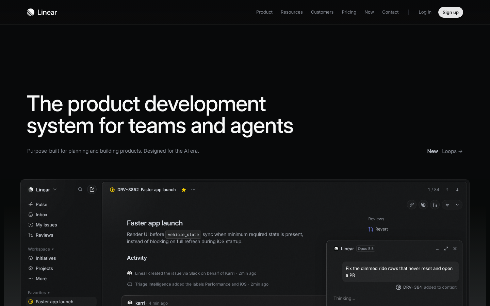 O que essa faz bem: no tema escuro o produto é o herói, uma janela grande que esmaece nas bordas.
- [x] Attio (design): 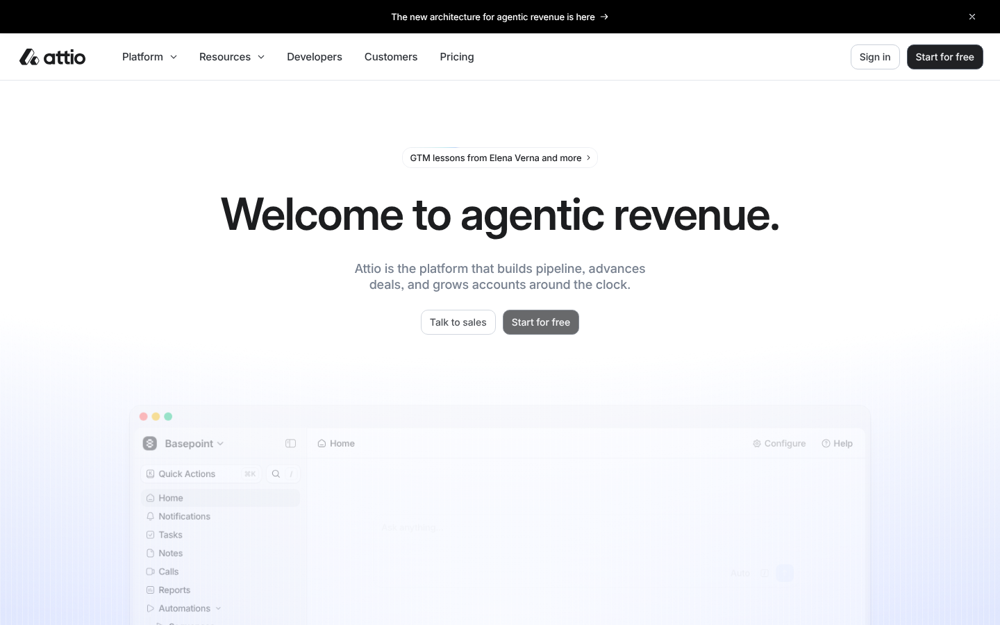 O que essa faz bem: título curto com ponto final e produto em cartões pequenos e legíveis, um por ideia.
- [x] Clinicorp (mesmo negócio):  O que essa faz bem: formulário de contato logo depois de explicar o que acontece depois de enviar.
- [ ] Simples Dental (mesmo negócio):  O que essa faz bem: um recurso por cartão com imagem do produto. Não levamos a arte promocional lotada.
- [ ] Cal.com (mesmo negócio, agendamento): 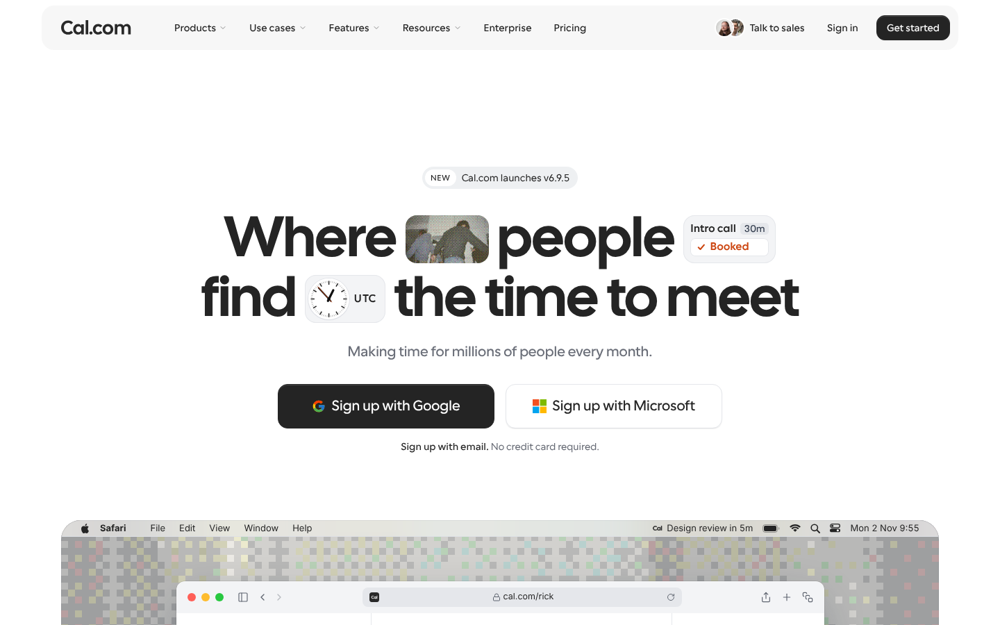 O que essa faz bem: elementos do produto dentro do título e uma ideia por tela.
- [ ] Vercel (design): 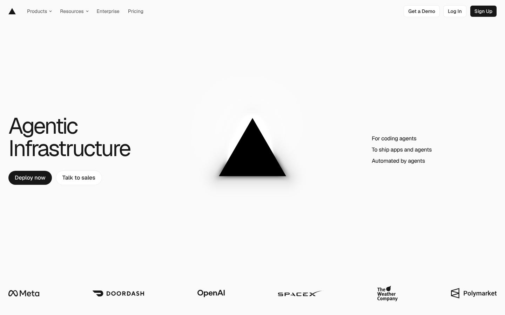 O que essa faz bem: o símbolo da marca como única imagem e uma lista curta de três linhas.
- [ ] Notion (design): 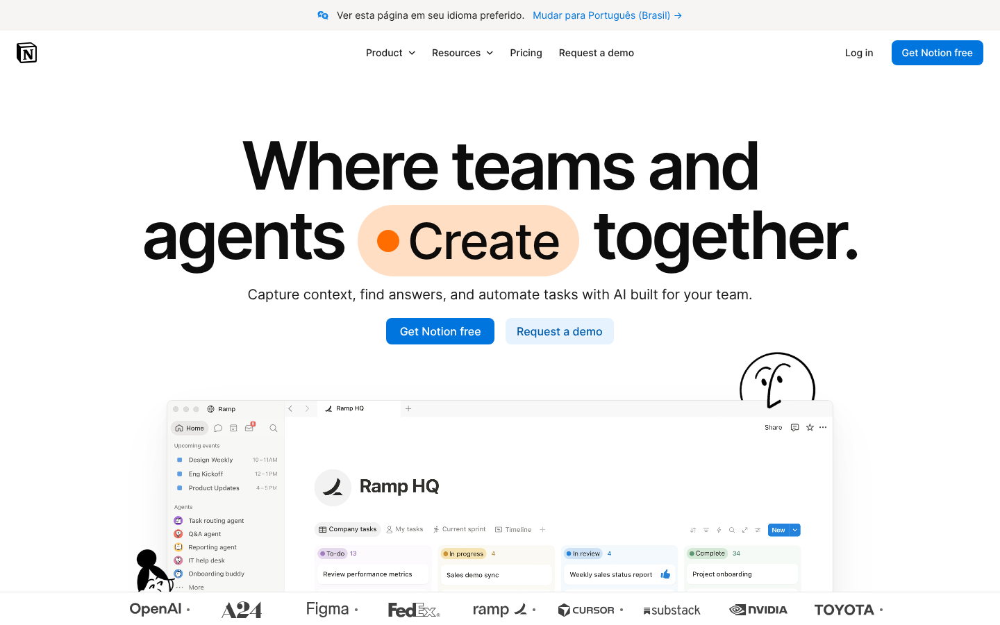 O que essa faz bem: mosaico de cartões de tamanhos diferentes que evita o molde repetido.

## b. Visual

As três direções usam o design system oficial da luxxen.ai. O texto das prévias é o texto real da página.

### Direção A: Produto em camadas

Tipografia: título 64/68 em peso 800, centralizado, Plus Jakarta Sans. Paleta: Midnight #0B0F1A, painel #11162A, violeta #7C3AED, azul #60A5FA, laranja lux #FF6B1A só em setas ». Imagem: a tela do funil de avaliações desenhada em HTML, com dois cartões flutuantes. Ritmo: uma ideia por tela, fundo escuro contínuo.
Celular: 

### Direção B: Agenda ao lado do texto
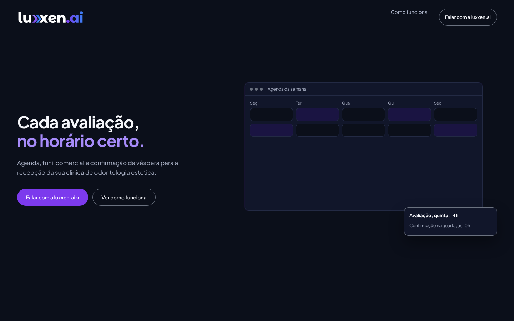
Tipografia: título 46/52 em peso 700 alinhado à esquerda. Paleta: Midnight, violeta, azul. Imagem: a agenda da semana e um cartão sobreposto. Ritmo: duas colunas, mais denso.
Celular: 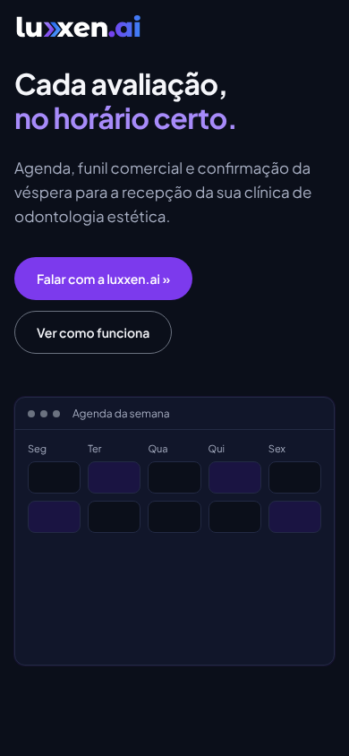

### Direção C: Painel claro
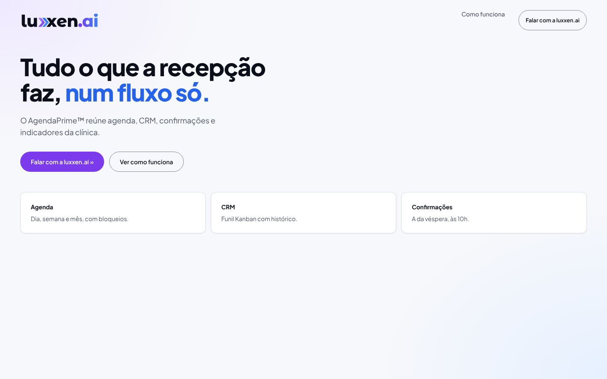
Tipografia: título 56/60 em peso 800 à esquerda. Paleta: branco-gelo, violeta, azul #2563EB, brilho lilás e azul-claro. Imagem: três cartões de recurso brancos, sem tela de produto. Ritmo: arejado, tema claro.
Celular: 

As três lado a lado: 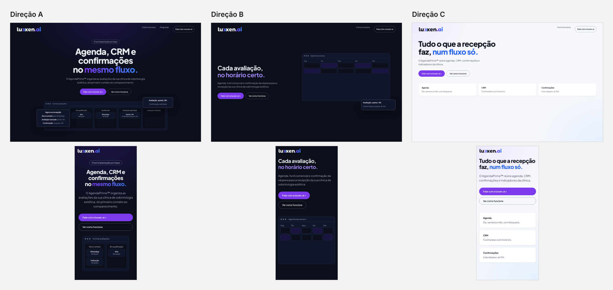

Recomendação: A. É a que traduz o que a zero4 faz de melhor (o produto em camadas na dobra) no tema escuro da luxxen.ai.

Escolha: [x] A  [ ] B  [ ] C  [ ] misturar: <o quê de cada>

## c. Seções

### Primeira dobra
- dobra-tipografica: 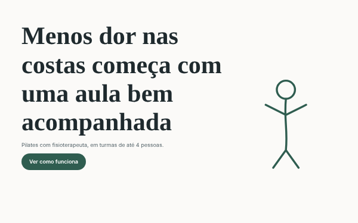 Quando usar: a frase é o argumento. Recomendo, com a tela do funil desenhada logo abaixo.
- dobra-split-imagem: 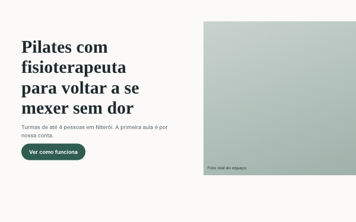 Quando usar: há uma foto forte. Não recomendo: não há foto.

### Dor
- caixas-iguais: 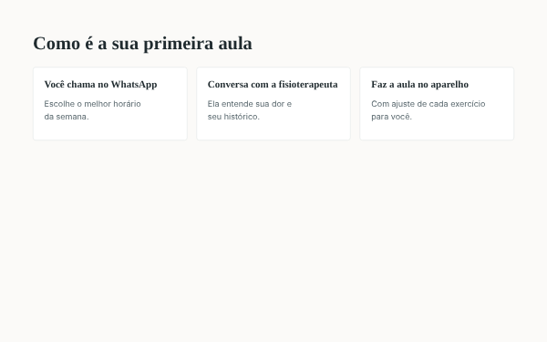 Quando usar: 3 ou 4 situações paralelas, cada uma com desenho próprio. Recomendo: as quatro dores do PRD, cada uma com uma mini interface.
- lista-editorial: 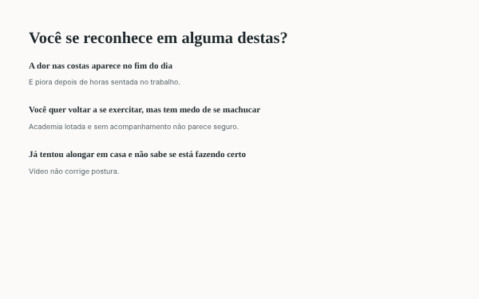 Quando usar: dores em frase inteira. Foi o formato da versão 1.

### Mecanismo ou diferencial
- split-imagem: 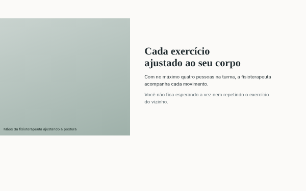 Quando usar: uma imagem prova o que o método faz. Recomendo, com abas que trocam a tela do produto.
- comparacao-assimetrica: 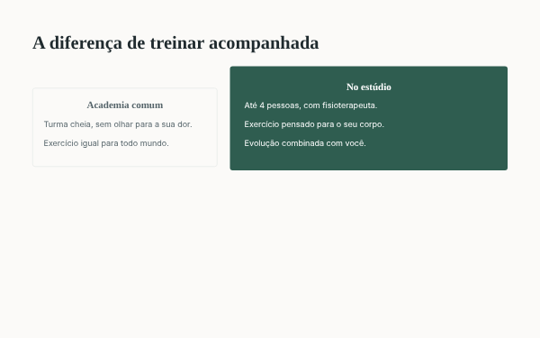 Quando usar: contraste real. Recomendo na seção "para quem é e para quem ainda não é".

### Prova
- caixas-iguais:  Quando usar: itens paralelos do mesmo peso. Recomendo para as regras do produto, já que não há depoimento nem número de clientes.
- depoimentos-grade: 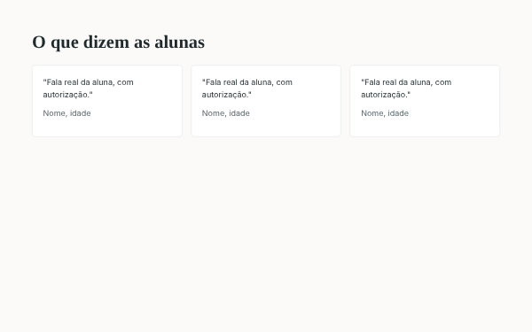 Quando usar: depoimento real com autorização. Não recomendo: não existe nenhum.

### Oferta
- fecho-split-contato: 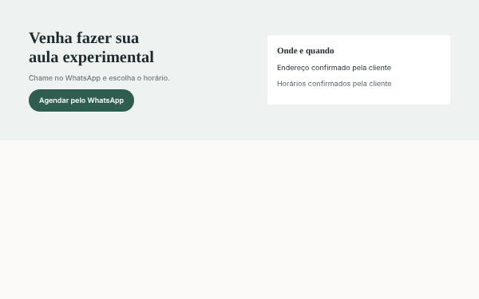 Quando usar: fechar com o contato. Recomendo, com o formulário em três etapas.
- oferta-bloco-unico: 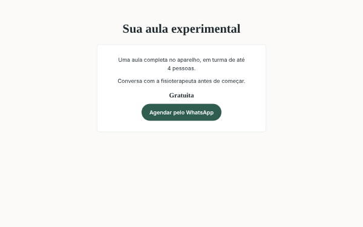 Quando usar: oferta com preço. Não recomendo: preço pendente.

### Como funciona
- linha-do-tempo: 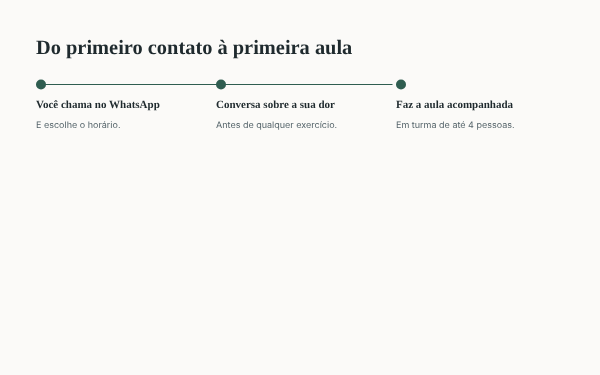 Quando usar: processo em que a ordem importa. Recomendo, em zigue-zague.
- caixas-iguais:  Quando usar: passos curtos do mesmo peso. Já usado na dor.

### FAQ
- faq-coluna-centrada: 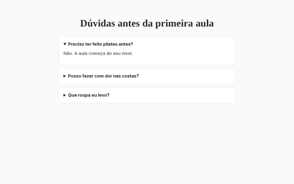 Quando usar: 4 a 7 dúvidas que travam a decisão. Recomendo.
- faq-duas-colunas: 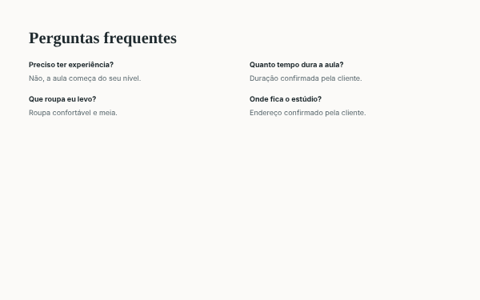 Quando usar: muitas dúvidas curtas.

### Fecho
- fecho-split-contato:  Quando usar: fechar com o contato. Mesmo bloco da oferta.
- fecho-faixa-cheia:  Quando usar: última frase e botão.

### Ordem escolhida
1. Primeira dobra: dobra-tipografica
2. Dor: caixas-iguais
3. Quatro telas do produto: split-imagem
4. Como funciona: linha-do-tempo
5. Quando a confirmação sai: split-imagem
6. Papéis: lista-editorial
7. Regras do produto: caixas-iguais
8. Para quem é: comparacao-assimetrica
9. Perguntas: faq-coluna-centrada
10. Fale com a luxxen.ai: fecho-split-contato

### Composição por seção

| Seção | Desktop | Celular | Animação |
|---|---|---|---|
| Primeira dobra | Título centralizado, dois botões e, embaixo, a tela do funil com dois cartões flutuantes | Título, apoio e botão na primeira tela; a tela do funil com duas colunas embaixo; barra fixa depois do herói | abertura-do-topo: o título sobe em escada e a tela do funil entra por último |
| Dor | Título à esquerda e quatro cartões iguais em duas colunas | Carrossel horizontal com encaixe, um cartão por vez | revelar-ao-entrar: cada cartão entra quando chega na tela |
| Quatro telas do produto | Abas e texto à esquerda, tela do produto à direita | Abas rolando de lado e a tela embaixo, em largura total | criação nova: ao trocar a aba, a tela do produto entra por camadas, primeiro a janela e depois os cartões |
| Como funciona | Linha central com cinco etapas alternando esquerda e direita, assimétrico | Coluna única com a linha à esquerda | assinatura: o cartão da avaliação passa a confirmação solicitada quando a quarta etapa entra |
| Quando a confirmação sai | Controles à esquerda e o resultado em cartão à direita | Controles em cima e o resultado embaixo | criação nova: o resultado troca de dia e de hora a cada escolha, com a hora das 10h em destaque |
| Papéis | Três linhas largas, nome à esquerda e descrição à direita | Três blocos empilhados | texto-em-linhas: cada descrição sobe linha por linha |
| Regras do produto | Três cartões escuros iguais com lista curta | Carrossel horizontal com encaixe | revelar-ao-entrar: cada cartão entra quando chega na tela |
| Para quem é | Duas listas lado a lado, a primeira maior, assimétrico | Duas listas empilhadas | texto-em-linhas: os itens entram linha por linha |
| Perguntas | Coluna centrada com seis perguntas | Coluna única | pergunta-que-abre: a resposta abre ao clique |
| Fale com a luxxen.ai | Texto à esquerda e formulário em três etapas à direita | Formulário em largura total, botão de 48 px | assinatura: o cartão chega a confirmada ao enviar; botao-com-seta no envio |

## d. Copy

| Seção | Frase | Linha do briefing que sustenta |
|---|---|---|
| Primeira dobra | Agenda, CRM e confirmações no mesmo fluxo. | "centraliza agenda de avaliações, CRM comercial, confirmações e indicadores operacionais" |
| Primeira dobra | V1 em implantação por fases | "A implantação ocorre em fases aprovadas individualmente." |
| Dor | A demora no atendimento custa oportunidades. | "perdem oportunidades comerciais por demora no atendimento" |
| Quatro telas do produto | Dia, semana e mês, com bloqueios, cancelamento e remarcação. | "Agenda própria configurável, visualizações dia/semana/mês; bloqueios; criar, cancelar e remarcar avaliações" |
| Quatro telas do produto | Um quadro Kanban com o histórico de cada movimentação. | "Registrar autor, origem, horário, etapa anterior e nova etapa de cada movimentação" |
| Como funciona | A avaliação de quinta, 14h gera a confirmação na quarta, às 10h. | "Avaliação quinta 14h em São Paulo gera job quarta 10h local." |
| Quando a confirmação sai | Sem disparo retroativo. | "Agendamento feito depois das 10h da véspera não gera disparo retroativo" |
| Papéis | Gerencia contatos, oportunidades, agenda, confirmações e comparecimento. | "**Recepção:** gerencia contatos, oportunidades, agenda, confirmações e comparecimento." |
| Regras do produto | Sem número inventado. | "Nenhuma métrica é inventada" |
| Para quem é | Quem precisa de prontuário ou anamnese. | "Prontuário, anamnese, diagnóstico ou gestão clínica." |
| Fale com a luxxen.ai | Preencha os dados da clínica e siga para o WhatsApp da luxxen.ai. | "seguir para o WhatsApp da luxxen.ai, (81) 96617-5561" |

### Pendências do cliente
- PENDENTE: preço ou forma de contratar. A página não publica preço.
- PENDENTE: política de privacidade.
- PENDENTE: prints reais do AgendaPrime. Até lá, telas desenhadas com dados fictícios, avisadas no rodapé.
- PENDENTE: domínio final.
- PENDENTE: texto da mensagem que abre no WhatsApp.
- PENDENTE: o tokens.css oficial não veio no pacote; o da página é gerado do tokens.json.

## e. Pixel e rastreamento

Nenhum pixel foi pedido. Se você for anunciar a página, avise e eu adiciono o Meta Pixel e o GA4. Os IDs ficam vazios até você preencher. Eventos marcados no código por `data-evento`: clique_whatsapp, clique_cta, rolagem_50, rolagem_90, envio_formulario.

## f. Código e publicação

HTML e CSS próprio sobre os tokens da luxxen.ai, sem CDN e sem biblioteca. O formulário não tem servidor: ao enviar, o navegador abre `https://wa.me/5581966175561` com a mensagem pronta. Fora do domínio final a página sai com `noindex` e `robots.txt` com `Disallow: /`. No domínio final sai o `noindex`, o `robots.txt` libera o site, a `og:image` vira endereço absoluto e o `canonical` aponta para o domínio. A versão 1 continua intacta na pasta `apps/agendaprime-landing/`.

Domínio final: a definir

## g. Aprovação

- [x] a. Referências
- [x] b. Visual
- [x] c. Seções
- [x] d. Copy
- [x] e. Pixel e rastreamento
- [x] f. Código e publicação
