# PLANO: AgendaPrime™ (luxxen.ai)

Pixel pedido: nenhum

Momento assinatura: o cartão de uma avaliação (quinta, 14h) desenhado como exemplo; seções: agenda, como funciona, fecho; estados: marcada -> confirmação solicitada -> confirmada

Ícone do site: o duplo chevron » da luxxen.ai no squircle escuro, a partir do arquivo oficial luxxen-icon-dark.svg

Material da cliente pedido:
- Prints reais do AgendaPrime quando existirem (hoje a página usa desenho próprio, marcado como exemplo)
- Política de privacidade (o formulário coleta nome e telefone)
- Preço ou forma de contratar
- Domínio final
- Confirmar o texto da mensagem que abre no WhatsApp

## a. Referências

Marque com [x] as que você gosta.

- [ ] Clinicorp (mesmo negócio):  O que essa faz bem: coloca o formulário de contato logo depois da dobra e diz o que acontece depois de enviar; a tabela "manual contra automatizado" mostra o mecanismo em linhas curtas.
- [ ] Simples Dental (mesmo negócio): 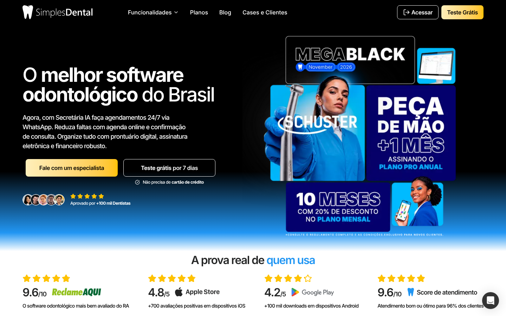 O que essa faz bem: dá a cada recurso uma captura do produto e um título de benefício. O que ela faz mal e não levamos: arte promocional lotada e nota com estrelas.
- [ ] Cal.com (mesmo negócio, agendamento): 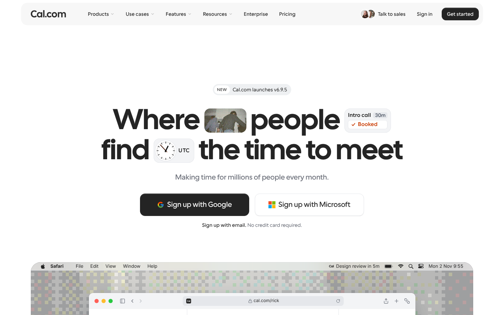 O que essa faz bem: elementos pequenos do produto dentro do título (um chip "Booked") mostram o que ele faz sem screenshot; uma ideia por tela, muito respiro.
- [ ] Attio (design): 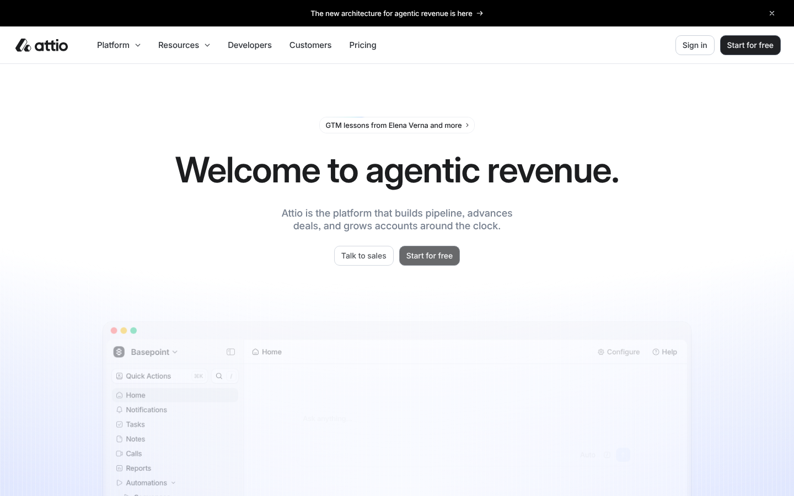 O que essa faz bem: título curto com ponto final e produto em cartões pequenos e legíveis, um por ideia.
- [ ] Linear (design): 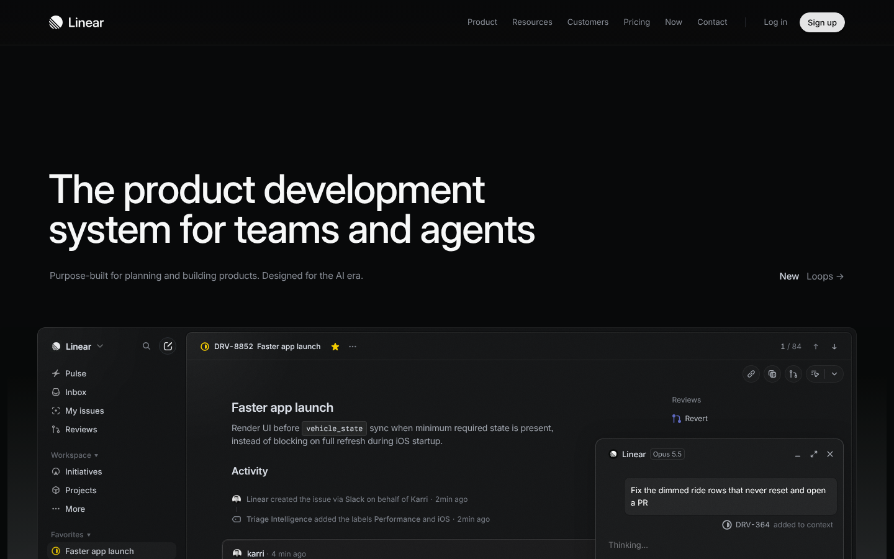 O que essa faz bem: no tema escuro o produto é o herói, uma janela grande que esmaece nas bordas, com pouquíssimo texto.
- [ ] Stripe (design): 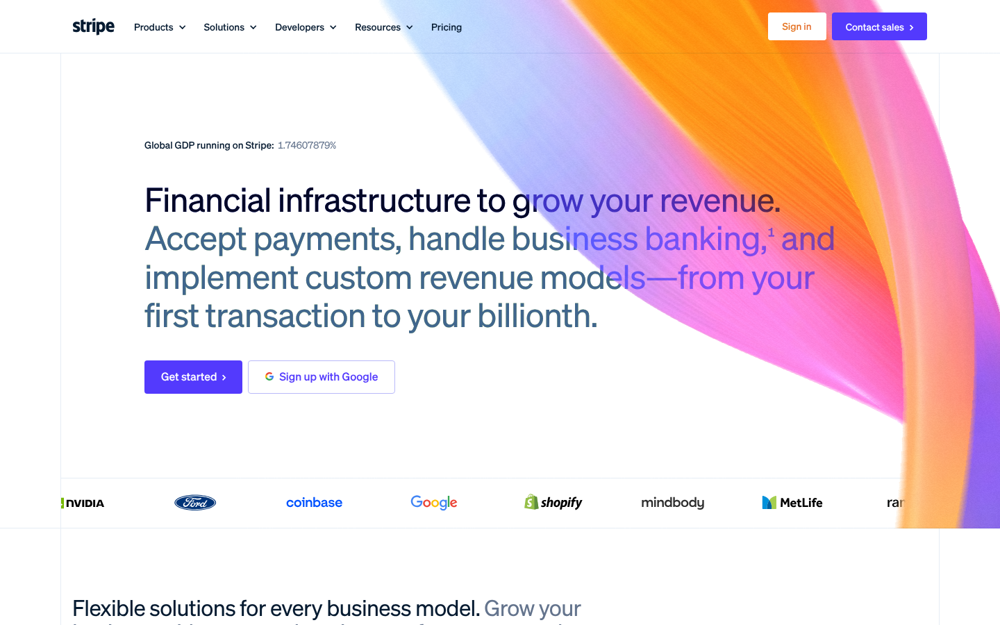 O que essa faz bem: uma única forma de luz entrando pelo canto como elemento decorativo. Cuidado: ela passa por trás do texto, o que a luxxen.ai proíbe.
- [ ] Vercel (design): 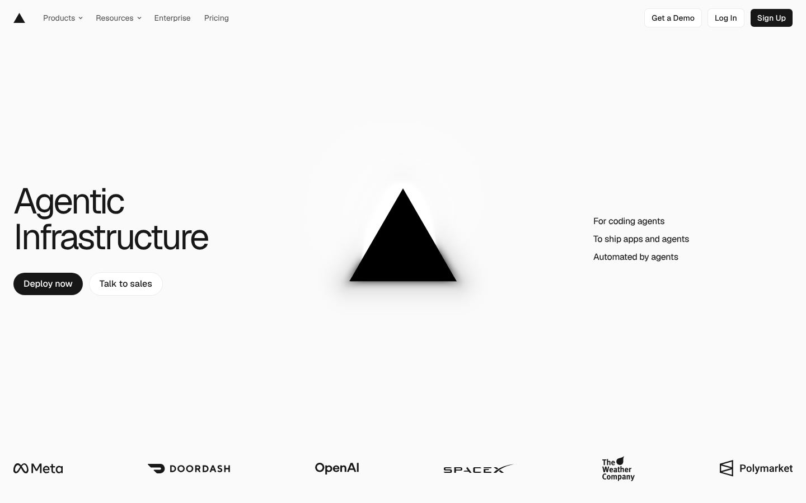 O que essa faz bem: o símbolo da marca é a única imagem da dobra, com luz suave, e uma lista de três linhas diz o que o produto faz.
- [ ] Notion (design): 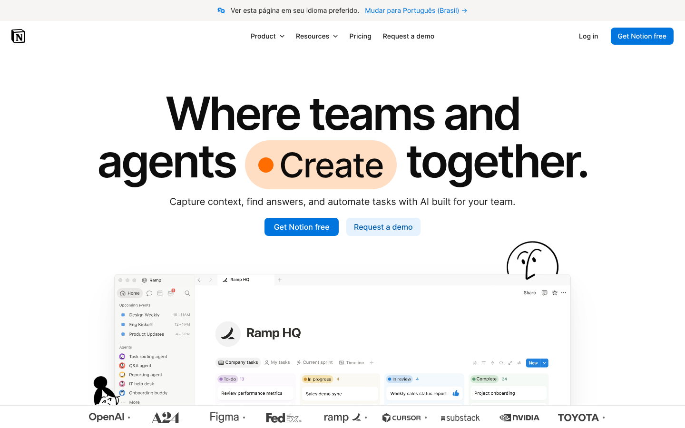 O que essa faz bem: uma palavra do título em pílula colorida já basta como destaque; mosaico de cartões de tamanhos diferentes evita o molde repetido.

## b. Visual

As três direções usam o design system oficial da luxxen.ai (Plus Jakarta Sans, violeta, azul e laranja só de destaque, logo SVG oficial). Elas mudam o tema, a composição, a imagem e o ritmo. O texto das prévias é o texto real da página.

### Direção A: Feixe de luz

Tipografia: título display 72/76 em peso 800 alinhado à esquerda, corpo 18/28. Paleta: Midnight #0B0F1A, violeta #7C3AED, azul elétrico #3B82F6, laranja lux #FF6B1A só no chevron, texto #F5F6FA. Imagem: nenhuma foto; o chevron grande de três setas na borda direita e linhas de luz violeta e azul. Ritmo: arejado, uma ideia por tela, tema escuro do começo ao fim.
Celular: 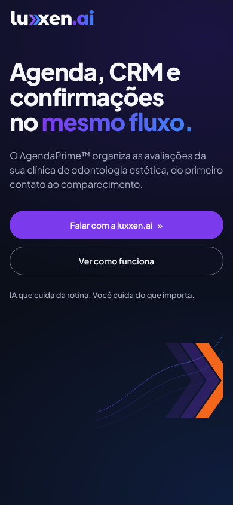

### Direção B: Agenda em primeiro plano
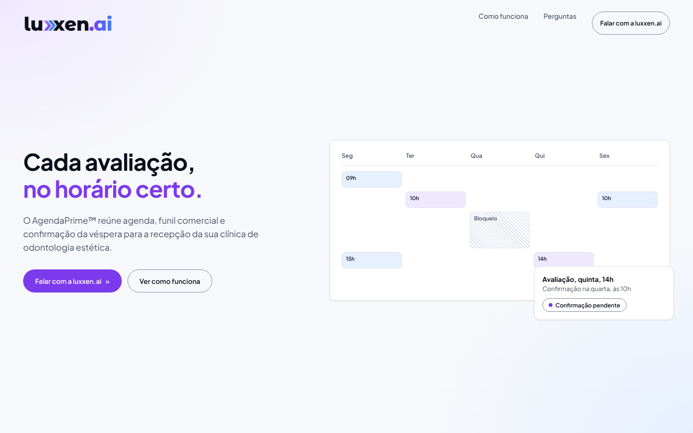
Tipografia: título 48/56 em peso 700, mais contido, com o destaque em violeta. Paleta: branco-gelo #F7F8FB, painéis brancos, violeta #7C3AED, azul #2563EB no texto, brilho lilás e azul-claro nos cantos. Imagem: o produto desenhado em cartões, uma semana de agenda com um bloqueio e o cartão da avaliação de quinta, 14h. Ritmo: mais denso, tema claro, leitura de produto.
Celular: 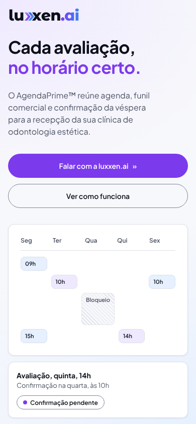

### Direção C: Conexão

Tipografia: título centralizado 60/66 em peso 800, com a palavra final numa pílula violeta dentro da frase. Paleta: Midnight, violeta, azul, rede de pontos em azul fino; sem laranja na dobra além das setas ». Imagem: o funil de cinco etapas do PRD como fluxo com » laranja e um Kanban que esmaece embaixo. Ritmo: centralizado, simétrico, escuro.
Celular: 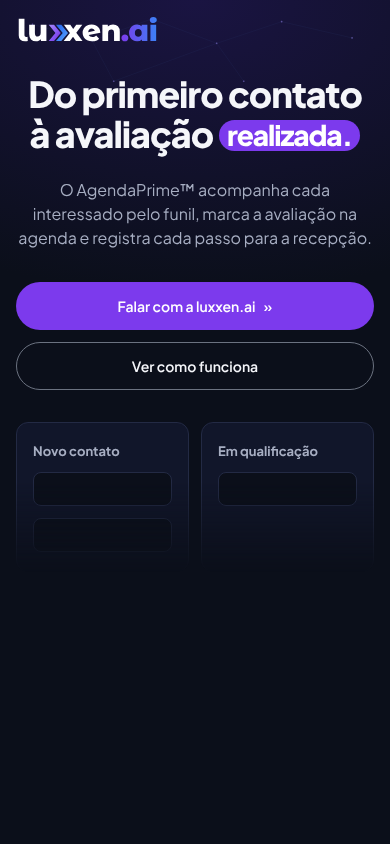

As três lado a lado: 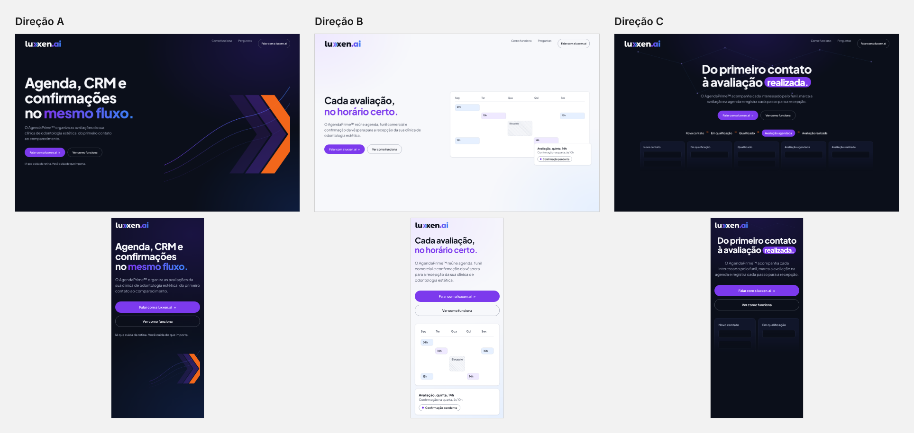

Minha recomendação: A na primeira dobra (é o rosto da marca no tema escuro, e a luz do chevron é o motivo "fluxo e movimento"), com o fluxo de etapas da C aparecendo na seção "Como funciona" e o cartão de avaliação da B como momento assinatura. Dobra escura e página interna clara também é uso previsto pelo design system.

Escolha: [ ] A  [ ] B  [ ] C  [ ] misturar: <o quê de cada>

## c. Seções

### Primeira dobra
- dobra-tipografica: 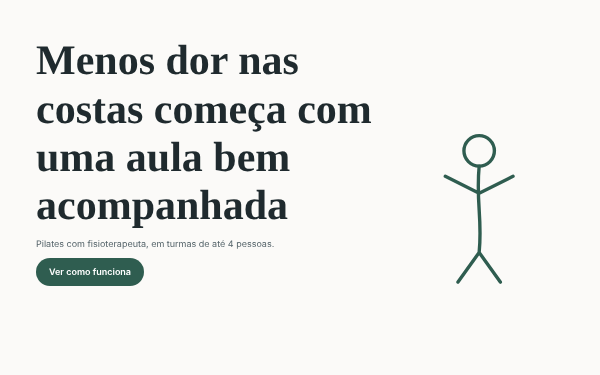 Quando usar: ainda não há foto boa, ou a frase é o argumento. Recomendo: não há foto nenhuma do produto ou da clínica, então o título e o chevron carregam a dobra.
- dobra-split-imagem: 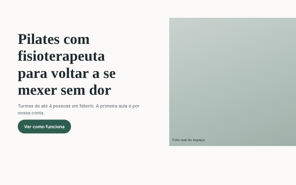 Quando usar: há uma foto forte e a promessa cabe em duas linhas. Não recomendo: sem foto real.

### Dor
- lista-editorial: 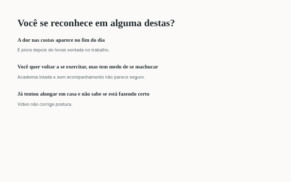 Quando usar: dores ditas em frase inteira, lidas como conversa. Recomendo: as quatro dores do PRD cabem como frases.
- faixa-destaque: 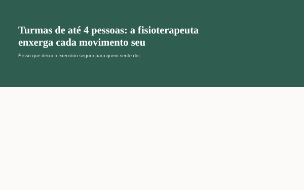 Quando usar: uma frase só que resume a dor e dá respiro.

### Mecanismo ou diferencial
- caixas-iguais: 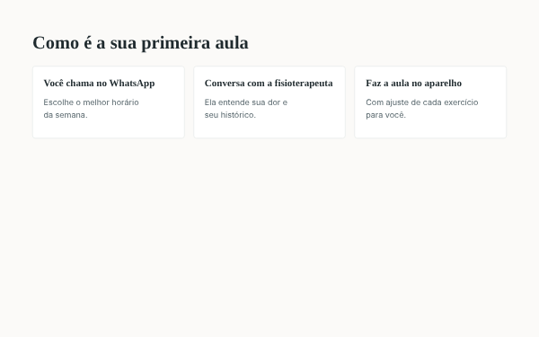 Quando usar: 3 ou 4 itens paralelos do mesmo peso, cada um com desenho próprio. Recomendo para as quatro telas (Agenda, CRM, Confirmações, Indicadores).
- split-imagem: 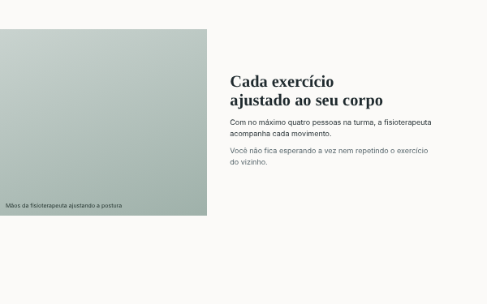 Quando usar: quando uma imagem prova o que o método faz. Recomendo para a agenda, com o desenho do produto no lugar da foto.
- comparacao-assimetrica: 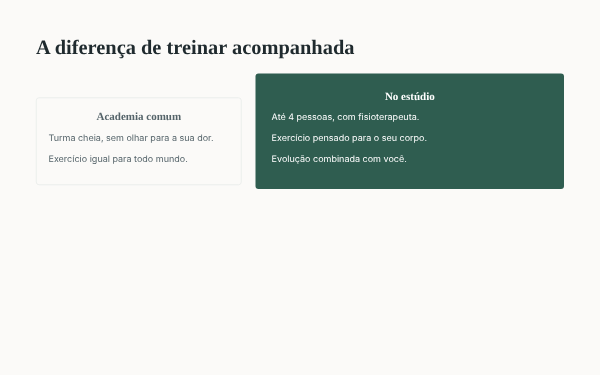 Quando usar: quando existe contraste real entre o jeito comum e o seu. Não recomendo: o PRD não descreve o que a clínica usa hoje.

### Prova
- faixa-destaque:  Quando usar: uma frase só, com respiro. Recomendo para os limites do produto ("Sem número inventado"), já que não existe depoimento, caso nem número de clientes.
- credencial-retrato: 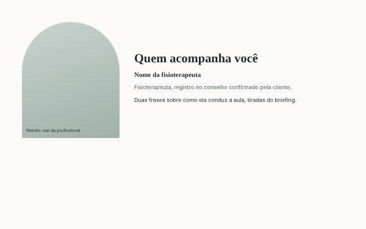 Quando usar: mostrar quem atende, com registro confirmado. Não recomendo: não há pessoa nem registro.
- depoimentos-grade: 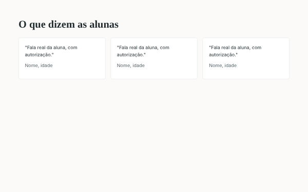 Quando usar: só com depoimento real e autorização. Não recomendo: não existe nenhum.

### Oferta
- fecho-split-contato: 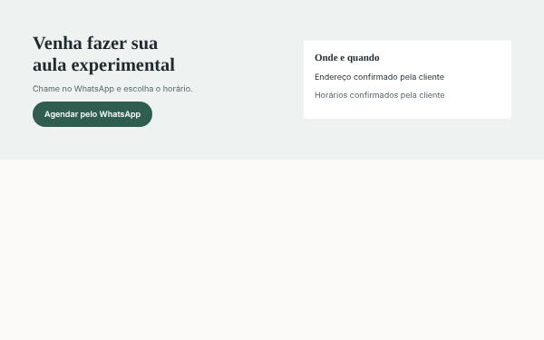 Quando usar: negócio que fecha com contato. Recomendo, com o formulário no lugar do endereço: a oferta é a conversa pelo WhatsApp.
- oferta-bloco-unico: 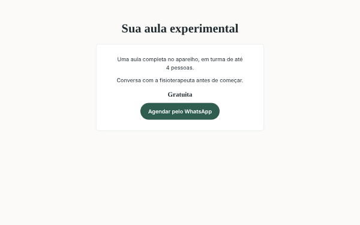 Quando usar: uma oferta só, com preço. Não recomendo: o preço é pendência.

### Como funciona
- linha-do-tempo: 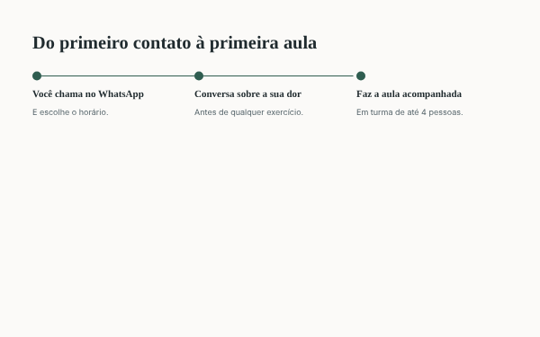 Quando usar: processo em que a ordem importa, sem número nos marcos. Recomendo: a jornada do PRD (contato, qualificação, avaliação, confirmação, comparecimento).
- caixas-iguais:  Quando usar: passos curtos do mesmo peso. Já usado na seção de telas.

### FAQ
- faq-coluna-centrada: 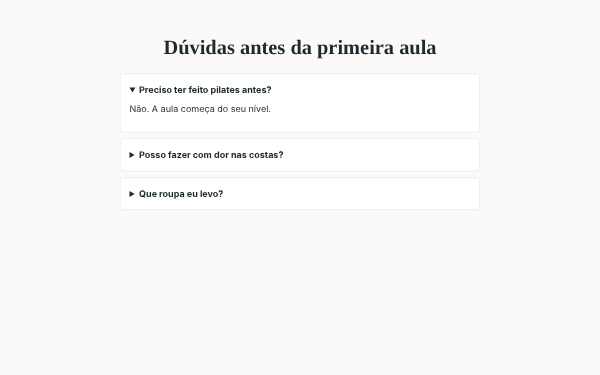 Quando usar: 4 a 7 dúvidas que travam a decisão, abrindo ao clique. Recomendo.
- faq-duas-colunas: 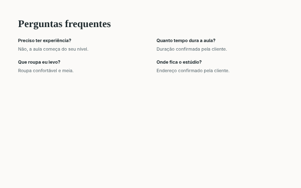 Quando usar: muitas dúvidas curtas, todas à vista.

### Fecho
- fecho-split-contato:  Quando usar: fechar com o contato. É o mesmo bloco da oferta.
- fecho-faixa-cheia: 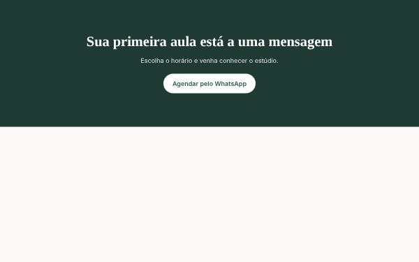 Quando usar: última frase e o botão.

### Ordem escolhida
1. Primeira dobra: dobra-tipografica
2. Dor: lista-editorial
3. Quatro telas do produto: caixas-iguais
4. Agenda, o mecanismo: split-imagem
5. Como funciona: linha-do-tempo
6. Limites do produto: faixa-destaque
7. Perguntas: faq-coluna-centrada
8. Fale com a luxxen.ai (formulário que abre o WhatsApp): fecho-split-contato

### Composição por seção

| Seção | Desktop | Celular | Animação |
|---|---|---|---|
| Primeira dobra | Título à esquerda, chevron grande e linhas de luz à direita, dois botões | Título, apoio e botão na primeira tela; chevron menor embaixo; barra fixa depois do herói | abertura-do-topo: o título entra por linhas e as linhas de luz se desenham |
| Dor | Título à esquerda, quatro frases em lista editorial à direita | Título e quatro frases em coluna única | texto-em-linhas: cada frase sobe linha por linha ao entrar |
| Quatro telas do produto | Título em largura total e quatro caixas iguais com desenho próprio | Carrossel horizontal com encaixe, uma caixa por vez | traco-que-se-desenha: o desenho de cada caixa se traça ao entrar |
| Agenda, o mecanismo | Desenho da agenda semanal largo à esquerda, texto estreito à direita, assimétrico | Texto primeiro e o desenho da agenda embaixo, em largura total | assinatura: o cartão da avaliação de quinta, 14h aparece marcado na grade |
| Como funciona | Título fixo à esquerda e linha do tempo de cinco marcos à direita, assimétrico | Título e marcos em coluna única, linha vertical | titulo-fixo: o título fica fixo enquanto os marcos sobem; o cartão passa a confirmação solicitada |
| Limites do produto | Faixa cheia com uma frase e três limites curtos | Faixa cheia, uma frase por vez | painel-de-cor: o fundo passa de Midnight para um painel violeta ao entrar |
| Perguntas | Coluna centrada com seis perguntas | Coluna única, perguntas largas para o toque | pergunta-que-abre: a resposta abre ao clique |
| Fale com a luxxen.ai | Texto à esquerda, formulário de três campos à direita | Formulário em largura total, botão de 48 px | assinatura: o cartão chega a confirmada quando o formulário é enviado; botao-com-seta no envio |

## d. Copy

| Seção | Frase | Linha do briefing que sustenta |
|---|---|---|
| Primeira dobra | Agenda, CRM e confirmações no mesmo fluxo. | "centraliza agenda de avaliações, CRM comercial, confirmações e indicadores operacionais" |
| Primeira dobra | O AgendaPrime™ organiza as avaliações da sua clínica de odontologia estética, do primeiro contato ao comparecimento. | "gestor ou proprietário de clínica de odontologia estética premium" |
| Primeira dobra | IA que cuida da rotina. Você cuida do que importa. | "Tagline: IA que cuida da rotina. Você cuida do que importa." |
| Dor | A demora no atendimento custa oportunidades. | "perdem oportunidades comerciais por demora no atendimento" |
| Dor | Sem acompanhamento consistente, o interessado some no meio do caminho. | "acompanhamento inconsistente" |
| Dor | Agenda desorganizada vira conflito de horário. | "agenda desorganizada" |
| Dor | Sem visibilidade, ninguém sabe onde cada interessado parou. | "falta de visibilidade sobre o percurso do interessado até a avaliação realizada" |
| Quatro telas do produto | Agenda: dia, semana e mês, com bloqueios, cancelamento e remarcação. | "Agenda própria configurável, visualizações dia/semana/mês" |
| Quatro telas do produto | CRM: um quadro Kanban com histórico de cada movimentação. | "Registrar autor, origem, horário, etapa anterior e nova etapa de cada movimentação." |
| Quatro telas do produto | Confirmações: a da véspera, às 10h no fuso da clínica. | "Programar confirmação para 10h da véspera, no fuso da clínica." |
| Quatro telas do produto | Indicadores: contatos, oportunidades, agendamentos, cancelamentos, remarcações, confirmações, comparecimento e pendências. | "Cards: contatos, oportunidades, agendamentos, cancelamentos, remarcações, confirmações, comparecimento e pendências." |
| Agenda, o mecanismo | Duas pessoas não ocupam o mesmo horário. | "Impedir sobreposição inclusive sob concorrência de requisições." |
| Agenda, o mecanismo | Os horários livres seguem o fuso da clínica. | "Consultar horários disponíveis considerando regras e fuso da clínica." |
| Como funciona | Novo contato, em qualificação, qualificado, avaliação agendada e avaliação realizada. | "Novo contato; Em qualificação; Qualificado; Avaliação agendada; Avaliação realizada; Encerrado/perdido." |
| Como funciona | A avaliação de quinta, 14h gera a confirmação na quarta, às 10h. | "Avaliação quinta 14h em São Paulo gera job quarta 10h local." |
| Como funciona | Sem resposta, a avaliação continua ativa e pendente. | "Sem resposta, avaliação permanece ativa e pendente; não cancelar automaticamente." |
| Como funciona | Quem registra o comparecimento é a equipe. | "só equipe autorizada marca comparecimento ou ausência" |
| Limites do produto | Sem número inventado. | "Nenhuma métrica é inventada" |
| Limites do produto | A IA não faz diagnóstico nem orçamento. | "IA não realiza diagnóstico, recomendação clínica ou orçamento definitivo." |
| Limites do produto | O AgendaPrime™ não é prontuário nem sistema financeiro. | "Prontuário, anamnese, diagnóstico ou gestão clínica." |
| Perguntas | A V1 está sendo implantada por fases. | "A implantação ocorre em fases aprovadas individualmente." |
| Perguntas | Um agente do GPTMaker no WhatsApp só entra depois de validado. | "Integração autenticada com GPTMaker, após validação técnica." |
| Perguntas | Sem resposta à confirmação, a avaliação não é cancelada. | "Sem resposta, avaliação permanece ativa e pendente; não cancelar automaticamente." |
| Perguntas | Cada clínica enxerga só os próprios dados. | "Uma plataforma, múltiplas clínicas com isolamento real de dados." |
| Fale com a luxxen.ai | Fale com a luxxen.ai. | "Formulário com nome e sobrenome, nome da clínica e WhatsApp da clínica, que abre o WhatsApp (81) 96617-5561 da luxxen.ai" |
| Fale com a luxxen.ai | Preencha os dados da clínica e siga para o WhatsApp da luxxen.ai. | "Formulário com nome e sobrenome, nome da clínica e WhatsApp da clínica, que abre o WhatsApp (81) 96617-5561 da luxxen.ai" |

### Pendências do cliente
- PENDENTE: preço ou forma de contratar. A página não publica preço.
- PENDENTE: política de privacidade, necessária porque o formulário coleta nome e telefone.
- PENDENTE: prints reais do AgendaPrime. Até lá, desenho próprio marcado como exemplo.
- PENDENTE: domínio final.
- PENDENTE: texto da mensagem que abre no WhatsApp.
- PENDENTE: o tokens.css oficial não veio no pacote da marca (só o tokens.json). O tokens.css da página é gerado do tokens.json; se você tiver o oficial, eu troco.

## e. Pixel e rastreamento

Nenhum pixel foi pedido. Se você for anunciar a página, avise e eu adiciono o Meta Pixel e o GA4. Os IDs ficam vazios até você preencher; eu não coloco ID real no plano. Eventos já marcados no código por `data-evento`, sem custo e sem dependência: clique_whatsapp, clique_cta, rolagem_50, rolagem_90, envio_formulario.

## f. Código e publicação

HTML + Tailwind compilado, sem CDN, com a fonte Plus Jakarta Sans local e o logo SVG oficial. O formulário não tem servidor: ao enviar, o navegador abre `https://wa.me/5581966175561` com uma mensagem pronta contendo nome, clínica e WhatsApp da clínica. Enquanto não houver domínio, a página sai com `noindex`, `robots.txt` com `Disallow: /`, sem sitemap e `og:image` relativa. No domínio final: sai o `noindex`, o `robots.txt` libera o site, a `og:image` vira endereço absoluto e o `canonical` aponta para o domínio. Publicação sugerida: Cloudflare Pages ou outro hospedeiro de página estática, a combinar com você.

Domínio final: a definir

## g. Aprovação

- [ ] a. Referências
- [ ] b. Visual
- [ ] c. Seções
- [ ] d. Copy
- [ ] e. Pixel e rastreamento
- [ ] f. Código e publicação
